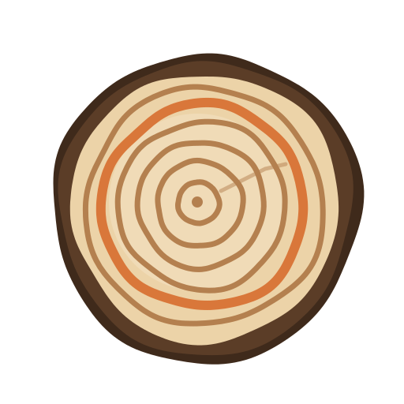
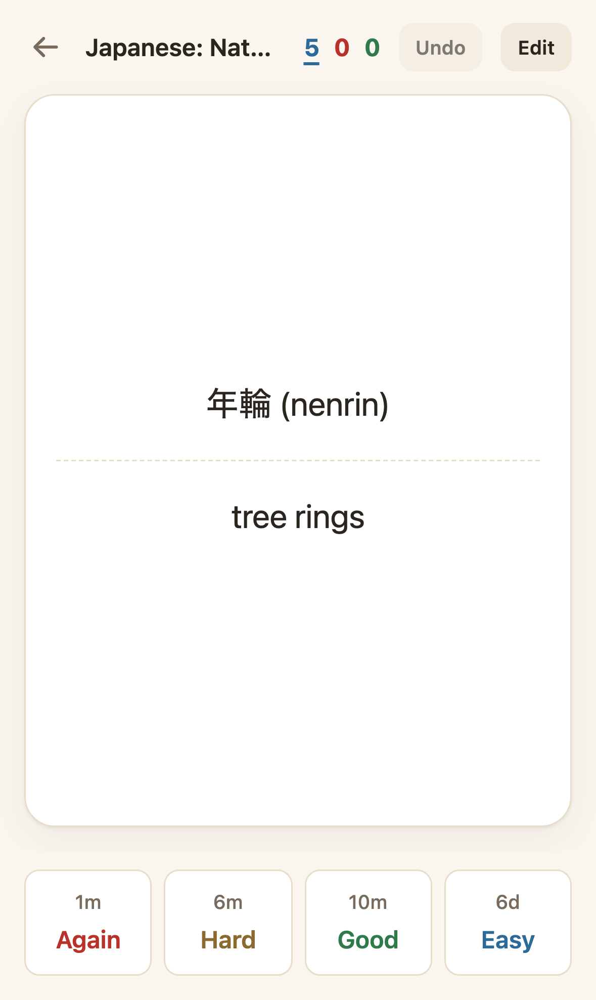
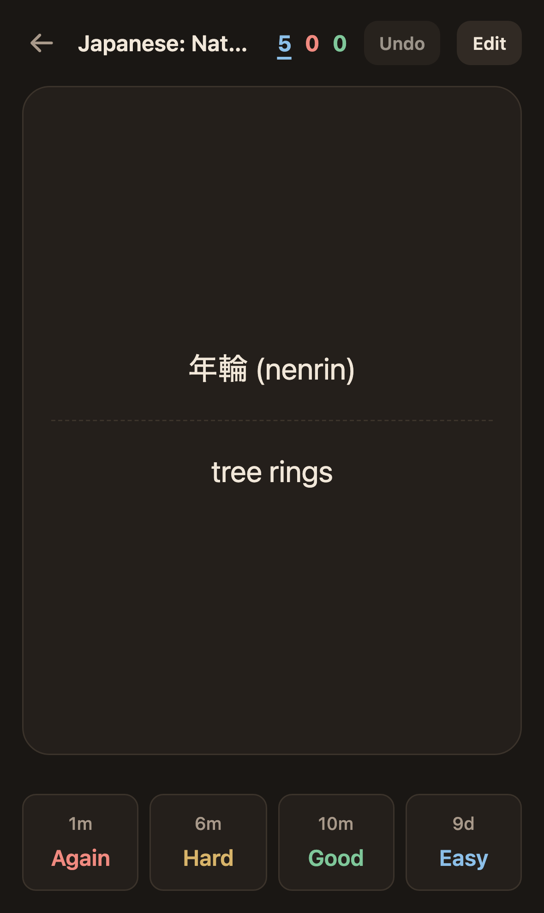
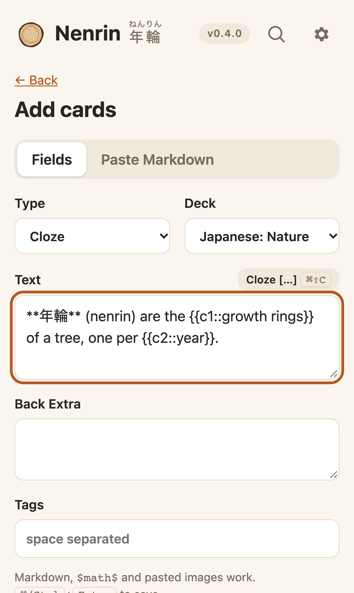
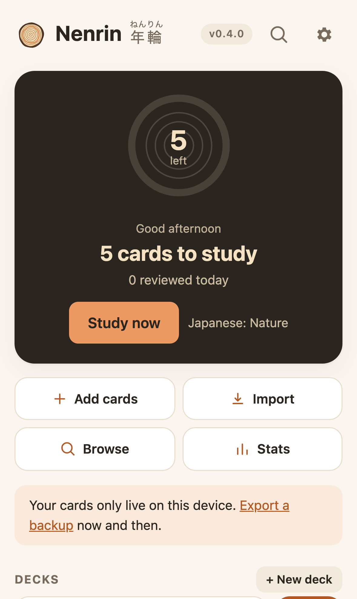

<p align="center">
  
</p>

<h1 align="center">Nenrin <ruby>年輪<rp>(</rp><rt>ねんりん</rt><rp>)</rp></ruby></h1>

<p align="center">
  <strong>Memory grows ring by ring.</strong><br>
  Free, open-source, local-first flashcards with <a href="https://en.wikipedia.org/wiki/Spaced_repetition#Algorithms">FSRS</a> <a href="https://en.wikipedia.org/wiki/Spaced_repetition">spaced repetition</a>.<br>
  An MIT-licensed alternative to Anki.
</p>

<p align="center">
  <a href="https://parmsam.github.io/nenrin/"><strong>Open the app →</strong></a>
</p>

<p align="center">
  <a href="https://github.com/parmsam/nenrin/actions/workflows/ci.yml"></a>
  <a href="CHANGELOG.md"></a>
  <a href="LICENSE"></a>
  
  
  
</p>

<p align="center">
  
  &nbsp;
  
  &nbsp;
  
  &nbsp;
  
</p>

> **Status: v0.4.0, pre-alpha, usable for daily study.** See the [changelog](CHANGELOG.md). Import your Anki decks (`.apkg` / `.colpkg`) or make your own Basic, Reversed and Cloze cards with Markdown, math and images, and review them with FSRS, offline. See [PLAN.md](PLAN.md).

## What's in the name

**<ruby>年輪<rt>ねんりん</rt></ruby> (nenrin)** means "tree rings" in Japanese. A tree adds one ring each year, and the rings are what make the trunk strong. [Spaced repetition](https://en.wikipedia.org/wiki/Spaced_repetition) works the same way: each review adds a ring, and each ring makes the memory last longer.

## Why another flashcard app?

Anki has the best scheduler and the biggest deck ecosystem, but its interface is dated, and its iPhone app costs $24.99. Newer apps look better, but most are closed source and subscription-based. They also tend to hide their scheduling algorithm, gate sync or card limits behind a paywall, or require an account.

Nenrin aims for the middle ground:

- **Modern scheduling.** [FSRS](https://github.com/open-spaced-repetition), the Free Spaced Repetition Scheduler (via `ts-fsrs`), with optional on-device parameter optimization. It's a newer, more accurate alternative to the SM-2 algorithm Anki used by default for years; see [how spaced repetition algorithms compare](https://en.wikipedia.org/wiki/Spaced_repetition#Algorithms).
- **Brings your Anki decks along.** Import `.apkg` / `.colpkg` with media, plus CSV/TSV.
- **Local-first and private.** Works offline, needs no account, has no analytics, and keeps your data on your device.
- **Runs everywhere.** It's an installable PWA (iPhone, iPad, Android, desktop browsers), with an optional native macOS wrapper.
- **Calm, fast UI.** Keyboard-first review on desktop and thumb-friendly on mobile.
- **Truly free.** MIT license, no paywalled features, no card limits.

See [COMPARISON.md](COMPARISON.md) for how this stacks up against Anki, RemNote, Mochi, Noji, AlgoApp, and others.

## What works today

- **Decks and sub-decks**: create, rename, delete, and per-deck settings (new cards per day, reviews per day, desired retention)
- **Browse and search**: find any note with Anki-style search (`deck:`, `tag:`, `is:due`, `-exclude`, `\"phrases\"` …), then suspend, move, tag or delete in bulk
- **Card types**: Basic, Basic (and reversed card), and Cloze (`{{c1::answer::hint}}`), with Anki-compatible templates
- **Paste from an LLM**: switch the editor to _Paste Markdown_ and paste what ChatGPT, Claude and the like give you. One card is split into front and back (at `---`, `Q:`/`A:` labels, a heading, or the first paragraph); a whole set becomes many cards (numbered Q/A pairs, a Markdown table, or cloze paragraphs). Clozes are detected, and a final `Tags:` line adds tags
- **Rich cards**: Markdown, LaTeX math (`$x^2$`, `$$…$$`) via KaTeX, and pasted images, with a live preview
- **Review**: FSRS-6 scheduling, learning steps, interval previews on each button, sibling burying, and undo
- **Keyboard-first**: <kbd>Space</kbd> to show the answer or rate Good, <kbd>1</kbd>–<kbd>4</kbd> to rate, <kbd>Z</kbd> to undo, <kbd>E</kbd> to edit, <kbd>Esc</kbd> to leave; press <kbd>?</kbd> for the full list
- **Import from Anki**: `.apkg` decks and `.colpkg` collections (modern and legacy formats) with images, audio, sub-decks and, optionally, your review history and FSRS memory. Re-importing an updated deck updates notes without touching your progress. Deck styling is applied safely inside each card (with automatic dark mode), and card audio autoplays (<kbd>R</kbd> replays)
- **Anki-compatible text import/export**: `.txt` / `.csv` / `.tsv` with Anki's file headers (`#separator`, `#html`, `#deck column`, `#guid column` …), column mapping, and update/skip/duplicate handling. Export as Anki's "Notes in Plain Text"
- **Stats**: review heatmap, retention, streaks, a 30-day forecast and cards by stage, per deck or overall
- **Personal scheduling**: optimize FSRS to your own review history with the official optimizer (WASM, on your device)
- **Your data**: JSON backup and restore, including review history and images; a configurable day rollover hour; persistent-storage request
- **Themes**: System / Light / Dark, with Wood, Matcha, Sakura and Indigo accents
- **Offline PWA**: install it on any device; it works with no network. When a new version is deployed, it asks before reloading

## Install it

Open **<https://parmsam.github.io/nenrin/>**, then:

- **iPhone / iPad:** Share → _Add to Home Screen_
- **Mac (Safari):** File → _Add to Dock_
- **Chrome / Edge / Android:** the install icon in the address bar, or menu → _Install app_

After the first visit, it works fully offline.

## Planned features (v1)

| Area          | Feature                                                                                |
| ------------- | -------------------------------------------------------------------------------------- |
| Study         | FSRS-6 scheduling, Again/Hard/Good/Easy, undo, daily limits, desired-retention setting |
| Cards         | Basic, Basic + reverse, Cloze; Markdown + LaTeX (KaTeX); images and audio              |
| Organize      | Decks, sub-decks, tags, search, browse/edit                                            |
| Import/Export | Anki text files (done), `.apkg`/`.colpkg`, full JSON backup (done)                     |
| Insights      | Review heatmap, retention, forecast                                                    |
| Platform      | Offline PWA, GitHub Pages hosting, macOS app (Tauri)                                   |

## Tech stack

- **App:** TypeScript, Vite, Svelte 5 (small bundle, fast on low-end phones)
- **Scheduler:** [`ts-fsrs`](https://github.com/open-spaced-repetition/ts-fsrs) (FSRS-6). Later, [`fsrs-browser`](https://github.com/open-spaced-repetition/fsrs-browser) (fsrs-rs in WASM) for optimization
- **Storage:** IndexedDB via Dexie; media stored as Blobs
- **Offline:** service worker via `vite-plugin-pwa`
- **Diagrams and Typst (Phase 3):** [Pele](https://github.com/obsidianmd/pele) for Mermaid; [typst.ts](https://github.com/Myriad-Dreamin/typst.ts) for opt-in Typst (WASM, lazy-loaded)
- **Anki import (Phase 2):** `sql.js` (SQLite → WASM), `fflate` (zip), `fzstd` (newer zstd-compressed collections)
- **Desktop (later):** [Tauri 2](https://tauri.app) for a signed macOS `.app`
- **Hosting:** GitHub Pages via GitHub Actions

## Development

Requires Node 22+.

```bash
npm install
npm run dev          # local dev server
npm test             # unit tests (Vitest)
npm run test:e2e     # browser tests (Playwright; run `npx playwright install chromium` once)
npm run lint         # ESLint + Prettier
npm run build        # type-check + production build to dist/
npm run brand        # regenerate the logo from scripts/generate-brand.mjs
npm run screenshots  # regenerate public/screenshots/*.png
```

Every push to `main` runs CI and deploys to GitHub Pages.

## Contributing

Contributions are welcome. Read [CONTRIBUTING.md](CONTRIBUTING.md) and [AGENTS.md](AGENTS.md); humans and AI coding agents follow the same rules. Open an issue before starting large changes.

This project is openly **vibe-coded**: much of it is written with AI coding agents (Claude Code) and reviewed by a human. Tests, CI, and the rules in `AGENTS.md` are how we keep it honest.

## Acknowledgements

- [Anki](https://apps.ankiweb.net/) for pioneering open spaced repetition
- [open-spaced-repetition](https://github.com/open-spaced-repetition) for FSRS and its implementations ([awesome-fsrs](https://open-spaced-repetition.github.io/awesome-fsrs/))

Nenrin isn't affiliated with Anki or AnkiWeb.

## License

[MIT](LICENSE)
