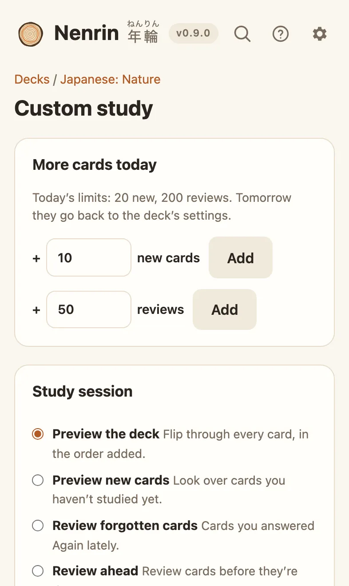

# Preview and custom study

## Preview a deck

On a deck, choose **Preview** (or press <kbd>P</kbd>) to flip through every card in the order they were added. Nothing is scheduled.

<kbd>Space</kbd> shows the answer and then moves on; <kbd>←</kbd> and <kbd>→</kbd> go back and forward; <kbd>1</kbd> (**Again**) puts the card at the end to see once more.

## Custom study

On a deck, choose **Custom study** (or press <kbd>C</kbd>). It's also offered when you finish a deck for the day.

<picture><source media="(prefers-color-scheme: dark)" srcset="images/custom-dark.webp"></picture>

**More cards today** raises today's limit of new cards or reviews for this deck. Tomorrow the limits go back to the deck's settings.

**Study session** gathers a set of cards for one session:

- **Preview the deck:** every card, in the order added
- **Preview new cards:** cards you haven't studied, optionally only recent ones
- **Review forgotten cards:** cards you answered Again in the last few days
- **Review ahead:** cards due in the next few days
- **Study by tag:** cards with any of the tags you list

Choose how many cards and their order (as added, by due date, or random), and whether **answers count as reviews**:

- **On:** each answer is scheduled by FSRS like a normal review.
- **Off:** practice only. Nothing is saved and no due dates change.

A session remembers your place, so you can edit a card or reload the page and carry on.
