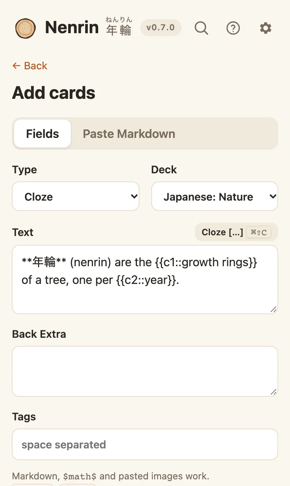

# Making cards

Open a deck and choose **Add cards** (or press <kbd>A</kbd> anywhere). Pick the deck and the type, fill in the fields, and press **Add** (<kbd>⌘Enter</kbd> / <kbd>Ctrl+Enter</kbd>). The preview shows the front and back as you type.

<picture><source media="(prefers-color-scheme: dark)" srcset="images/add-dark.webp"></picture>

## Card types

- **Basic:** a front and a back.
- **Basic (and reversed card):** two cards, front → back and back → front. Good for vocabulary.
- **Basic (optional reversed card):** like the reversed type, but the back → front card is made only when you type something (anything, such as `y`) in **Add Reverse**. Good when only some notes deserve both directions.
- **Basic (type in the answer):** you type the answer before you see it, and Nenrin shows what you got right and wrong. Good for spelling and short exact answers.
- **Cloze:** a sentence with parts hidden. Wrap each hidden part in `{{c1::…}}`. Use `c2`, `c3` … to make one card per part; parts with the same number are hidden together. Select text and press <kbd>⌘⇧C</kbd> / <kbd>Ctrl+Shift+C</kbd> to wrap it.

  `The {{c1::mitochondria}} produce most of the cell's {{c2::ATP}}.` makes two cards.

## Image occlusion

Hide parts of a picture and test yourself on them: labels on a diagram, bones, countries on a map.

1. In **Add cards**, choose the **Image Occlusion** type.
2. **Choose an image** (or paste one).
3. Drag over each part to hide. Each mask becomes its own card, numbered on the image. Select a mask (click it, or Tab to it) and press **Delete mask** or <kbd>Delete</kbd> to remove it.
4. Pick how cards look while you study:
   - **Hide all, guess one:** every mask stays covered, and the one to guess is red. Best when the parts give each other away.
   - **Hide one, guess one:** only the mask to guess is covered.
5. Add a **Header** (shown above the image) and **Back Extra** (shown with the answer) if you like, then **Add**.

On the answer side, the mask you guessed turns into a dashed outline so you can see what was under it. Image occlusion notes from Anki import as they are, and export back to Anki as Anki's own image occlusion type.

## Formatting

Fields use [Markdown](https://commonmark.org/help/): `**bold**`, `*italic*`, lists, `` `code` ``, tables and links.

- **Math:** `$E = mc^2$` inline, or `$$…$$` on its own line, written in LaTeX. Anki's `\(…\)` and `\[…\]` work too.
- **Diagrams:** a [Mermaid](https://mermaid.js.org/intro/syntax-reference.html) code block draws a diagram that follows your theme:

  ````markdown
  ```mermaid
  flowchart LR
    Learn --> Review --> Remember
  ```
  ````

- **Typst:** for math and layouts beyond LaTeX math (tables, aligned derivations, chemistry and more), put [Typst](https://typst.app/docs/) in a ` ```typst ` code block. Typst's compiler is a one-time download of about 32 MB, so it's off until you choose **Settings → Typst → Enable Typst** on each device. After that it works offline. Without it, the card shows the Typst source with a hint. Typst packages (`@preview/…`) aren't available.

  ````markdown
  ```typst
  $ integral_0^oo e^(-x^2) dif x = sqrt(pi) / 2 $
  ```
  ````

- **Images:** paste an image into a field. It's stored with your cards and works offline.

## Paste mode

Switch the editor to **Paste** to turn a block of text into cards. Nenrin splits it for you:

- `Q:` / `A:` lines (or `Question:` / `Answer:`, `Front:` / `Back:`)
- a line with just `---` between front and back
- a heading as the front and the rest as the back
- `{{c1::…}}` anywhere makes a cloze card

Several cards at once work too: repeated `Q:`/`A:` pairs, a two-column table, or several cloze paragraphs separated by blank lines. A last line like `Tags: biology exam` tags every card. This is the format to ask an LLM for: see [Make cards with an LLM](llm.md).

## Editing and finding notes

**Browse** (<kbd>B</kbd>) lists every note with Anki-style search: words, `"exact phrases"`, `-exclude`, `deck:Spanish`, `tag:verbs`, `is:due`, `is:new`, `is:suspended`, `added:7` and `*` wildcards. Select notes (<kbd>X</kbd>) to suspend, move, tag or delete them together.
