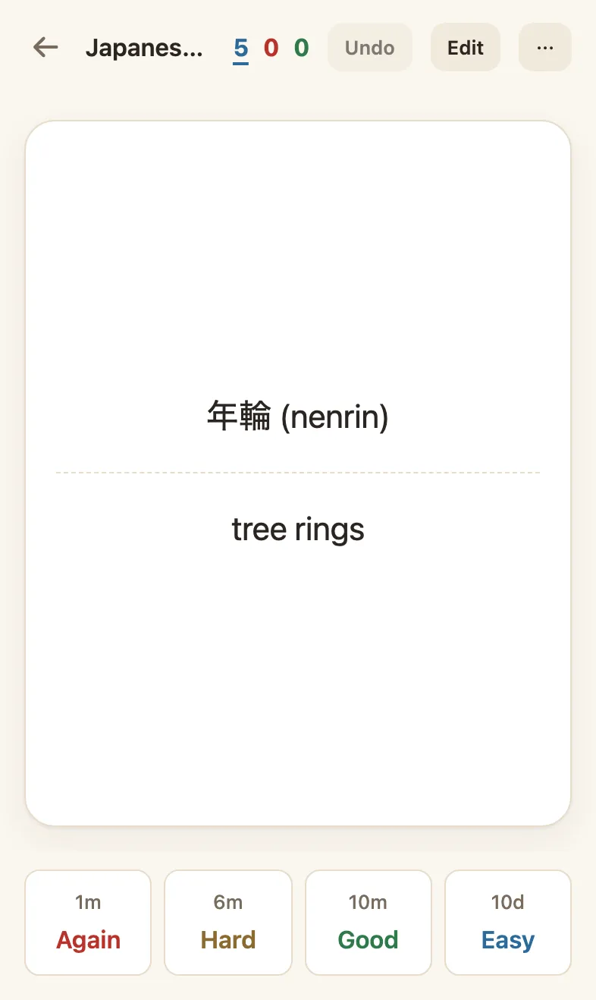

# Studying

## The four buttons

After you reveal the answer, rate how well you remembered it:

<picture><source media="(prefers-color-scheme: dark)" srcset="images/review-dark.webp"></picture>

| Button    | Key          | Use it when                                    | What happens                                                           |
| --------- | ------------ | ---------------------------------------------- | ---------------------------------------------------------------------- |
| **Again** | <kbd>1</kbd> | You forgot, or got it wrong                    | You'll see it again in a few minutes, and its next interval is shorter |
| **Hard**  | <kbd>2</kbd> | You remembered, but it was a real struggle     | A shorter interval than Good                                           |
| **Good**  | <kbd>3</kbd> | You remembered with some effort (most answers) | The normal next interval                                               |
| **Easy**  | <kbd>4</kbd> | It was effortless                              | A longer interval                                                      |

**Good** should be your usual answer. <kbd>Space</kbd> both reveals the answer and, pressed again, rates **Good**.

The small times above the buttons (like `10m`, `3d`, `1.2mo`) say when you'd see the card next with each choice.

## Typing the answer

Some cards ask you to type the answer (the **Basic (type in the answer)** note type, or Anki cards with `{{type:…}}`). Type it and press <kbd>Enter</kbd> to show the answer: what you typed appears above the correct answer, with wrong letters struck through in red and missed ones underlined. Case and accents count; extra spaces don't. Then rate yourself as usual: the comparison is a hint, the rating is your call.

## New, learning and review cards

The three numbers on a deck count today's cards:

- **Blue: new.** Cards you haven't studied yet. Each deck shows up to 20 a day by default.
- **Red: learning.** Cards you're learning or relearning today. They come back after a few minutes.
- **Green: review.** Cards you've learned that are due today. Up to 200 a day by default.

While you review, the same three numbers in the header count down what's left. Prefer a progress bar? Pick one in **Settings → Studying → Progress while reviewing**: a bar on its own, or with a percentage (40%) or a fraction (4 / 10). Cards you get wrong come back, so progress can step back a little.

You can change the daily limits, and the **desired retention** (how likely you want to be to remember a card when it comes due, 90% by default), under each deck's **Settings**. Higher retention means more reviews.

## How scheduling works

Nenrin uses [FSRS](https://github.com/open-spaced-repetition/fsrs4anki/wiki/The-Algorithm), the same scheduler as modern Anki. It estimates how well you know each card and shows it again when you're about to forget it. Cards you know well come back after weeks or months; hard ones come back sooner.

After a few hundred reviews you can tune FSRS to your own memory: open a deck's **Settings → Optimize for my reviews**. It runs on your device.

## Undo, edit, bury and suspend

While reviewing:

- **Undo** (<kbd>Z</kbd>) takes back your last rating, bury or suspend.
- **Edit** (<kbd>E</kbd>) opens the current note, then brings you back.
- **Bury** hides a card until tomorrow: <kbd>-</kbd> for this card, <kbd>=</kbd> for every card of the note.
- **Suspend** hides a card until you unsuspend it in **Browse**: <kbd>@</kbd> for this card, <kbd>!</kbd> for the whole note.
- The **⋯** button has bury and suspend for mouse and touch.

Cards made from the same note (like the two directions of a reversed card) are spread over different days automatically.

## Rewards (optional)

Turn on **Settings → Appearance → Rewards** for a few quiet extras built around the tree. They count showing up and finishing, never which button you press, so they never tempt you to rate a card **Good** when it was **Again**.

- **Session marks:** as a review session grows, a mark appears next to the counts: 木 (a tree) at 10 cards, 林 (a grove) at 25, 森 (a forest) at 50, then 100 and 200 with rings around it. Turn on the wood-block sound in the same place if you like.
- **Stamp book** (御朱印帳), in **Stats**: a red seal on each day you finished everything due, and a light mark on days you studied. A missed day is just blank; nothing is taken away.
- **Milestones** (節目): your first review, seven study days, the tree's first heartwood, a year of study, coming back after a long break, and 100, 1,000 and 10,000 mature cards. They show in the stamp book, and on "Done for now" the day you reach one.
- **Seasons:** the tree on the home screen gets cherry blossom in spring, leaves in summer, maple in autumn and snow in winter (northern-hemisphere seasons).

## Audio

Cards with audio play it when they appear, and the answer's audio when you reveal it. <kbd>R</kbd> replays it. You can turn autoplay off in **Settings → Studying**. On iPhone, Safari may block autoplay; tap the player or press <kbd>R</kbd>.
